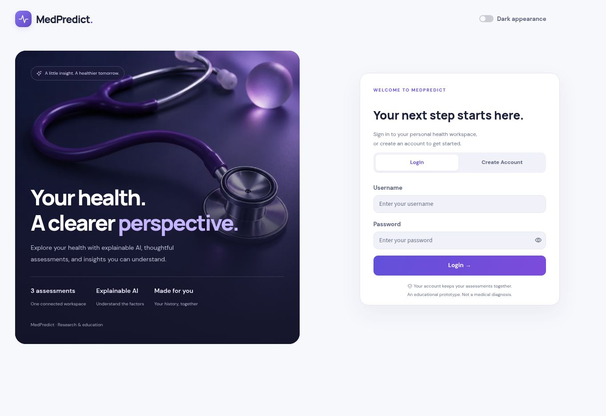
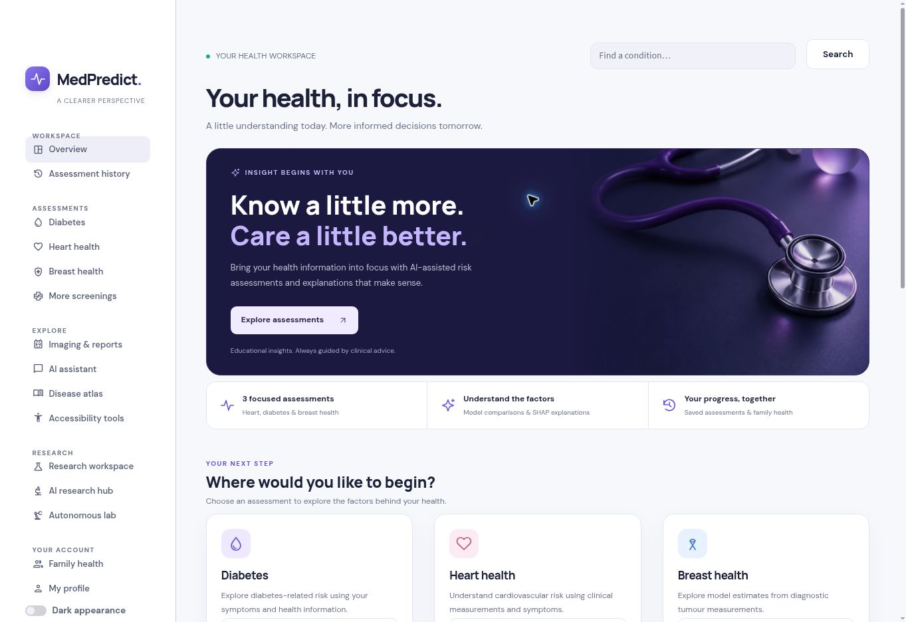
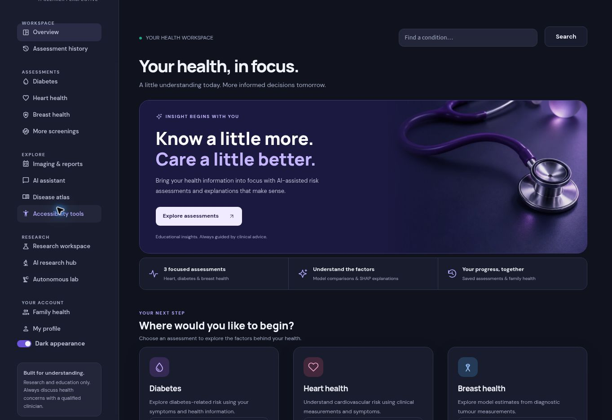

# MedPredict design refresh

The restored homepage and sign-in used several HealthAI/HealthGuard identities, a long decorative introduction, and inconsistent feature navigation. This refresh gives MedPredict one indigo/violet identity and puts the existing assessments directly after a compact welcome panel.

## Design references

- [Healthara](https://frihita.github.io/Healthara_2.0/): distinctive identity, rounded panels, dark/light appearance.
- [Namastey AI](https://arhita536.github.io/Namastey-AI__/): a clear introduction and a visual directory of features.
- [Kaamigo](https://arhitajain.github.io/kaamigo/): split visual/sign-in composition, typography, card hierarchy and spacing.

The implementation uses native Streamlit controls for authentication, navigation, forms and actions. Shared styles cover the overview and existing feature pages, with small-screen rules and reduced-motion support. Models, assessment calculations, account verification and saved-data formats are retained. Accessibility tools remain integrated within MedPredict.

## Preview

Screenshots are from the local Streamlit application with a synthetic preview session; no real account or health information is shown.

## Validation

- Python compilation and Git whitespace checks passed.
- Login and account-creation forms rendered. Empty-login validation passed.
- AST comparison confirmed that the complete login/signup/OTP conditional handling matches the original, with presentation branding updated.
- The dashboard, theme switching, search routing, assessment navigation and history page passed Streamlit AppTest checks.
- Diabetes, heart and breast assessment calculations ran with the existing sample inputs, without application exceptions or error messages.
- Desktop browser checks covered sign-in, the overview, assessment shortcuts, tabs and both appearances.
- Existing saved scikit-learn models emitted version warnings in the local test environment (saved with 1.9.0, executed with 1.8.0). These checks demonstrate that the presentation still runs; they do not establish clinical validity or model reproducibility across versions.
- Real email/OTP delivery, connected AI, camera recognition and the existing production deployment were not exercised. Mobile breakpoint rules were reviewed; physical-device testing remains outstanding.

## Deployment

Run the existing entry point, `streamlit run app.py`. No new Python dependencies, environment variables or data migration are required. The existing hosted app's URL and deployment configuration were not available in the project context, so this branch has not been verified on that deployment. The local preview harness is excluded from Git.

## Image asset

`assets/medpredict-studio.webp` is a new, locally embedded image, generated with the built-in image generator and optimised as WebP. It does not depend on an external image URL. The existing images are retained in the repository.

Generation prompt:

> Use case: product-mockup. Asset type: a polished background photograph for the MedPredict healthcare AI website sign-in page. Generate a premium editorial studio still life of a real silver stethoscope with deep violet tubing, arranged in a loose natural curved loop on a matte midnight-indigo surface, with a small frosted glass sphere and soft out-of-focus lavender light in the upper right. Rich dark blue and violet palette, subtle realistic reflections, soft directional studio light, tangible fine textures, sophisticated health technology mood, minimal and clean. Portrait 2:3 composition. Objects concentrated in the upper and middle-right half; lower left and bottom third should be dark calm negative space to place website heading text later. No text, no lettering, no numbers, no logos, no watermark, no screens, no charts, no human anatomy or people.
